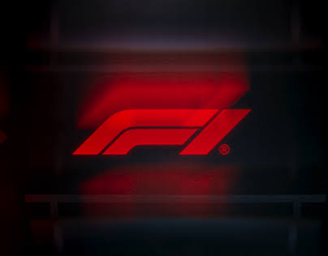
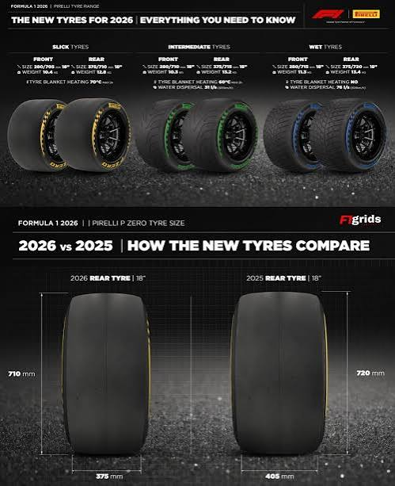
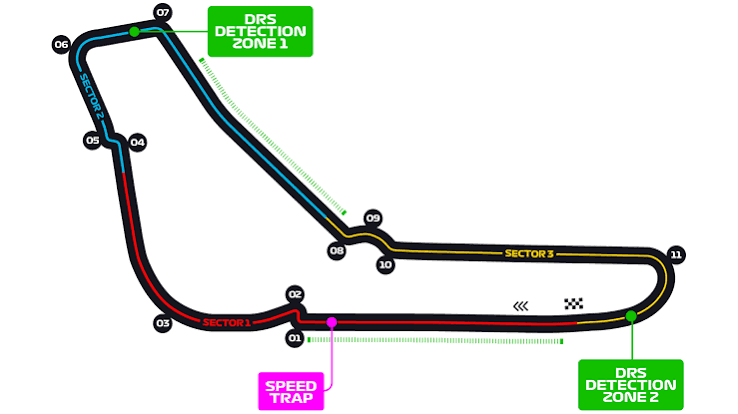

  

<h1 align="center">F1 Pit Stop Predictor</h1>

  Following the race. Learning the patterns. Anticipating the next pit stop.

  <strong>Deep Learning</strong> &nbsp;·&nbsp; Recurrent Neural Networks &nbsp;·&nbsp; Historical Race Replay

  <a href="#the-idea">The idea</a> &nbsp;·&nbsp;
  <a href="#our-approach">Our approach</a> &nbsp;·&nbsp;
  <a href="#race-replay">Race replay</a> &nbsp;·&nbsp;
  <a href="ProjectDescription/ProjectDescription.pdf">Project proposal</a>

---

## The idea

In Formula 1, a few tenths of a second can make a difference. As tyres age, lap times change and the race unfolds, teams have to decide when to bring their drivers into the pits. We want to explore how much of that decision we can anticipate from the laps already completed.

**At the end of each lap, we will estimate the probability that a driver will enter the pits within the next three laps.**

For example, a prediction made after lap **20** covers pit entries on laps **21, 22 and 23**. The prediction updates after each new lap, giving us a way to follow how the likelihood of a stop changes throughout the race.

## Our approach

We plan to train a **recurrent neural network (RNN)** on sequences of consecutive laps from one driver in one race. The goal is to learn whether recent changes in a driver's situation help anticipate their next pit entry.

| Stage | Role in the project |
| :--- | :--- |
| **Collect** | Use [FastF1](https://docs.fastf1.dev/) to obtain historical lap, tyre, position and track-status data. |
| **Prepare** | Build sequences using recent lap times, tyre compound and age, race position and track status. |
| **Label** | Set `PitWithin3Laps` to `1` if a pit entry occurs in the next three laps, and `0` otherwise. |
| **Predict** | Train an RNN to output the probability of a pit entry within that window. |
| **Replay** | Display predictions alongside the events of a historical race as each lap unfolds. |

Every prediction will use information available up to that lap. Historical `PitInTime` and `LapNumber` records will provide the outcomes used for training and evaluation.

### Reading the race

Tyre compound and age are part of the context we want the model to follow. Together with recent pace and track status, they describe how a driver's situation evolves from lap to lap.

  
   
  Tyre reference graphic. Model inputs will use the recorded tyre data for each historical race.

## Evaluating the predictions

We will compare the RNN with a **logistic regression baseline** trained on the current lap's features and the same prediction target.

- **Keep races together:** split complete races chronologically into training, validation and test sets.
- **Fit on training data:** learn preprocessing from the training set, then choose model settings and the alert threshold using validation races.
- **Measure useful predictions:** report precision, recall and F1 score on driver-lap examples, and examine false alarms and missed entries.

This will help us understand whether the recurrent model adds value and which race situations remain difficult to predict.

## Race replay

The replay experience is designed to follow a historical race lap by lap and display each driver's predicted probability of entering the pits. Actual pit entries appear as the replay reaches them, allowing viewers to compare the predictions with what happened on track.

  
   
  Circuit-map reference for the race replay experience.

By combining a lap-by-lap probability chart, actual pit entries and circuit context, the viewer aims to make the model's behaviour easier to understand. It gives Formula 1 fans a visual way to explore how a driver's situation changes as a race unfolds.

## Project documents

- [Read the project proposal](ProjectDescription/ProjectDescription.pdf)
- [View the LaTeX source](ProjectDescription/ProjectDescription.tex)

## The team

**Alejandro Tirado Ramirez** · **Simón Sloan García Villa**

Built around our interest in Formula 1, race data and deep learning.
