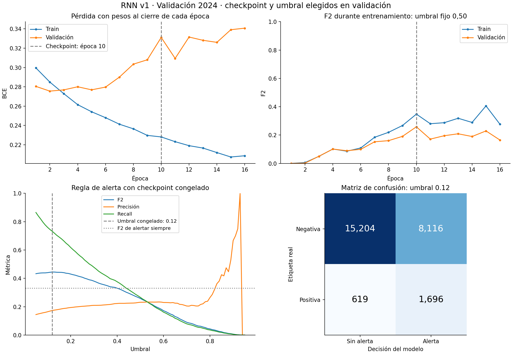

# Primera RNN: evaluación local de validación 2024

**Estado:** corrida de Colab recibida, integridad comprobada y evaluación local en CPU completada. Primera referencia experimental disponible; 2025 permanece reservada.

## Corrida y procedencia

- Paquete recibido: `runs/rnn_v1_seed42.zip`.
- SHA-256 del ZIP: `22330727955e278fdf7abbaec2eeb968934dcf1b7e24f4058ed4415ca7775fb8`.
- Modelo: una RNN tanh de 32 unidades, embeddings de dimensión 4, rama estática de 16 unidades y 4.121 parámetros.
- Entorno de Colab: Tesla T4, PyTorch 2.14.1+cu130, Python 3.13.16; semilla 42.
- Entrenamiento: 46.162 muestras elegibles de 2022–2023. Validación: 25.635 muestras elegibles de 2024, en 24 carreras.
- Tiempo registrado: 91,7 segundos; 16 épocas ejecutadas. Se conservó la época 10 y después transcurrieron seis épocas sin superar el criterio de checkpoint.
- Se comprobaron los hashes de los 16 archivos declarados en el manifiesto del modelo y los artefactos de entrada requeridos por el evaluador. El preprocesador se reutilizó congelado.

La predicción corresponde al inicio de N y el objetivo a una entrada emparejada dentro de N–N+2 y posterior a la decisión. Las características proceden del replay histórico con latencia cero supuesta. Estos resultados no acreditan latencia ni rendimiento en vivo.

## Paridad Colab–CPU

La evaluación local reutilizó los pesos, la definición del modelo, el preprocesador y el umbral exportados. La diferencia máxima de probabilidades fue **5,36 × 10⁻⁷**, dentro de las tolerancias declaradas (`atol=1e-5`, `rtol=1e-4`). **Ninguna decisión cambió** entre Colab y CPU.

El evaluador no entrenó, no reajustó transformaciones y no buscó un umbral nuevo. Comprobó también el hash de los eventos y del índice causal usado para recuperar el instante de decisión por clave.

## Resultados por muestra

Validación contiene 2.315 etiquetas positivas y 23.320 negativas; prevalencia positiva del 9,03 %.

| Regla de alerta sobre el mismo checkpoint | F2 | Precisión | Recall | TP | FP | FN | TN |
|---|---:|---:|---:|---:|---:|---:|---:|
| Umbral fijo 0,50 | 0,25835 | 23,14 % | 26,61 % | 616 | 2.046 | 1.699 | 21.274 |
| Umbral exportado 0,12 | **0,44463** | **17,28 %** | **73,26 %** | **1.696** | **8.116** | **619** | **15.204** |

Con umbral 0,12 se emitieron 9.812 alertas por muestra; el 82,72 % fueron falsos positivos. Son **31,66 falsos positivos por cada 100 decisiones elegibles**. Las alertas consecutivas pueden estar relacionadas y no equivalen a incidentes independientes.

Average Precision local es 0,20158, frente a una prevalencia de 0,09031. Como comprobación trivial del criterio, alertar siempre produciría F2=0,33171. La RNN mejora ese control, aunque conserva un costo alto de falsas alertas. Este control descriptivo no sustituye la referencia neuronal solicitada.

La época se eligió por mayor F2 a umbral fijo 0,50, con menor BCE como desempate. Después se seleccionó 0,12 sobre la cuadrícula acordada y con los pesos congelados. El resultado de 0,13 es muy próximo: no hay evidencia para tratar 0,12 como un óptimo estable entre corridas o temporadas.

## Cobertura por evento

Las 824 entradas emparejadas confirmadas de 2024 tienen al menos una oportunidad de predicción elegible. **652 tuvieron alguna alerta dentro del horizonte: cobertura del 79,13 %.** Las otras **172 no fueron cubiertas**.

Los 619 falsos negativos de la tabla son muestras piloto-vuelta; los 172 eventos omitidos son entradas a boxes. Los denominadores y las preguntas son diferentes.

De las 26.604 muestras publicadas de validación se excluyeron 969 conforme al contrato: 967 etiquetas publicadas desconocidas y dos muestras con etiqueta conocida pero predicción no elegible. Las desconocidas incluyen 875 horizontes incompletos, 66 eventos sin resolver y 26 muestras actuales generadas. No se reinterpretaron como negativas.

## Aprendizaje y errores

| Checkpoint elegido, época 10 | Entrenamiento | Validación |
|---|---:|---:|
| BCE | 0,22816 | 0,33111 |
| F2 con umbral 0,50 | 0,34786 | 0,25835 |
| F2 con umbral 0,12 | 0,61683 | 0,44463 |
| Average Precision | 0,52184 | 0,20158 |

La BCE de entrenamiento calculada al final de cada época desciende de 0,29955 a 0,20869. La de validación alcanza su mínimo en la época 2 (0,27557) y termina en 0,34070. Hay una brecha de generalización compatible con sobreajuste o cambios de distribución entre temporadas. Esta corrida no identifica su causa. Elegir la época 10 es coherente con el criterio F2 declarado, aunque la BCE de validación fuera mejor en la época 2.

Algunos casos que orientan la revisión de errores, usando siempre el umbral congelado:

| Carrera de 2024 | Evidencia |
|---|---|
| Mónaco, ronda 8 | F2=0,09181; 13 TP, 547 FP y 24 FN; precisión 2,32 %. |
| Italia, ronda 16 | Recall 31,11 %; 28 TP y 62 FN sobre 90 muestras positivas. |
| Países Bajos, ronda 15 | 825 FP pese a recall del 100 %; precisión 8,64 %. |
| São Paulo, ronda 21 | 860 FP pese a recall del 100 %; precisión 9,95 %. |

Las muestras de vueltas mayores a 60 agrupan 3 TP, 497 FP y 21 FN. Este corte mezcla duraciones de carrera y circuitos; es un diagnóstico descriptivo, no una causa demostrada. No se atribuyen estos errores a compuesto, stint, clima o máscaras sin realizar una revisión específica.



## Siguiente comparación propuesta

Conservar esta corrida como referencia. Antes de aumentar la red, revisar ejemplos FP/FN de las carreras anteriores y plantear una comparación de capacidad: **cambiar únicamente `hidden_size` de 32 a 16**, manteniendo datos, particiones, preprocesador, W=8, embeddings, rama estática, pérdida, optimizador, learning rate, semilla, presupuesto y protocolo de selección.

La hipótesis es que reducir capacidad podría disminuir la brecha de generalización. Debe comprobarse comparando F2, precision, recall y AP de train/validación, además de métricas por carrera. Se conservarán tanto el resultado a umbral fijo 0,50 como el obtenido con el mismo procedimiento de búsqueda de umbral. Regularización, nuevas características, ponderación de clases o cambios de learning rate serían ensayos separados.

Esta propuesta no fue ejecutada. No se modificaron los pesos, umbral, etiquetas ni reglas de la corrida actual. Validación se utilizó para seleccionar checkpoint y umbral; sus métricas son resultados de desarrollo y pueden ser optimistas. Una semilla no mide variabilidad. La prueba final 2025 sigue pendiente de una evaluación con protocolo/modelo congelados.

## Artefactos y reproducción

- Modelo extraído: `runs/rnn_v1_seed42/`.
- Evaluación: `eval/rnn_v1_validation/`, con métricas, predicciones, errores, cortes por carrera/piloto y cobertura por evento.
- Análisis complementario: `eval/rnn_v1_validation/analysis/`, con figura, resumen, nombres de carreras, generador y manifiesto propio. Los archivos originales del evaluador conservan sus hashes.

Para repetir la evaluación, usar un directorio de salida nuevo, desde un entorno con PyTorch instalado:

```bash
OMP_NUM_THREADS=2 MKL_NUM_THREADS=2 python3.13 -B scripts/evaluar_rnn.py \
  --bundle runs/rnn_v1_seed42 \
  --data EDA/dataset/muestras_preprocesadas_v1_3 \
  --output eval/rnn_v1_validation_replay_2 \
  --device cpu
```

Para reproducir únicamente el diagnóstico, sin inferencia ni ajuste:

```bash
python3.13 -B scripts/generar_diagnostico_rnn.py \
  --bundle runs/rnn_v1_seed42 \
  --evaluation eval/rnn_v1_validation \
  --events EDA/dataset/datos_carreras_completos_2022_2025/etiquetado_pit_entry_v3_2022_2025/events.csv \
  --output eval/rnn_v1_validation_analysis_2
```

El diagnóstico requiere matplotlib además de las dependencias del experimento. No se hizo commit ni push.
