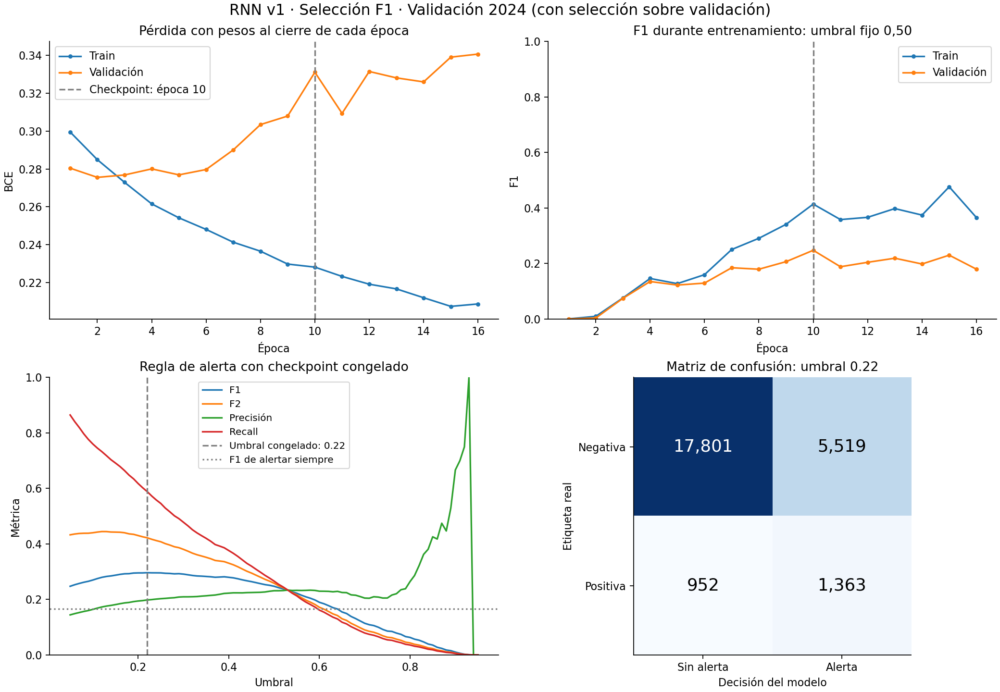

# RNN con selección F1: resultados y comparación con F2

**Estado:** corrida F1 recibida, integridad verificada y evaluación local en CPU completada sobre validación 2024. Prueba final 2025 reservada. No hubo entrenamiento local ni ajuste adicional de umbral durante la evaluación.

## Corrida e integridad

- Archivo recibido: `runs/rnn_f1_v1_seed42.zip`.
- SHA-256: `7135dc17eac094bca3ead6960a67fd56c2ee6bf65e48bdee38167686de8c6c3a`.
- Se verificaron los 16 archivos del manifiesto, la identidad `rnn_reference_f1_v1`, el estado completo y el contrato de selección F1/beta=1.
- Se reutilizaron los mismos datos, orden de características, preprocesador, W=8 y arquitectura de 4.121 parámetros.
- Train: 46.162 muestras elegibles de 2022–2023. Validación: 25.635 muestras elegibles de 2024, con 2.315 positivas.
- Se ejecutaron 16 épocas y se seleccionó la época 10 por mayor F1 de validación a umbral fijo 0,5. Después se eligió umbral 0,22 con los pesos congelados.
- El criterio sí intervino: en la época 8, F1 no guardó checkpoint mientras F2 sí lo había hecho. Ambos criterios terminaron eligiendo la época 10.

La reproducción local difiere de las probabilidades exportadas como máximo **1,19 × 10⁻⁷**. Cumple las tolerancias declaradas y presenta **cero cambios de decisión**. El instante de decisión y los eventos se recuperaron de las fuentes locales fijadas por hash.

## Comparación sobre la misma validación

| Corrida y criterio de decisión | Umbral | F1 | F2 | Precisión | Recall por muestra | FP | FN | Eventos cubiertos |
|---|---:|---:|---:|---:|---:|---:|---:|---:|
| Referencia F2 | 0,12 | 0,27971 | **0,44463** | 17,28 % | **73,26 %** | 8.116 | 619 | 652/824 (79,13 %) |
| Control F1, pesos F2 congelados | 0,22 | **0,29640** | 0,42219 | **19,81 %** | 58,88 % | **5.519** | 952 | 552/824 (66,99 %) |
| Nueva corrida con selección F1 | 0,22 | **0,29640** | 0,42219 | **19,81 %** | 58,88 % | **5.519** | 952 | 552/824 (66,99 %) |

La nueva corrida produce 1.363 TP, 5.519 FP, 952 FN y 17.801 TN. Hay 6.882 alertas por muestra: el 80,19 % son falsas. Son 21,53 falsos positivos por cada 100 decisiones elegibles. Las 969 muestras excluidas conservan las mismas reglas de elegibilidad y etiquetas desconocidas de la evaluación anterior.

Respecto a la referencia F2, F1 sube 0,01669 y F2 baja 0,02244. Se reducen **2.597 falsos positivos (32 %)** a costa de **333 falsos negativos adicionales**, y se cubren 100 entradas a boxes menos. Los FN cuentan muestras piloto-vuelta; los eventos no cubiertos pasan de 172 a 272 y tienen otro denominador.

## Qué explica el resultado

Los conteos y métricas de decisión de la nueva corrida coinciden exactamente con el control F1 sobre los pesos F2 congelados. Al aplicar a ambas corridas un mismo umbral de 0,12, 0,22 o 0,50, hay cero diferencias en sus decisiones. A umbral fijo 0,50 ambas producen F1=0,24754 y F2=0,25835.

Average Precision es prácticamente igual: 0,20157751 en la referencia y 0,20157753 en la nueva corrida. La evidencia disponible indica que el cambio operativo observado se reproduce íntegramente mediante el umbral; **no hay evidencia de mejor aprendizaje ni de mayor capacidad de separación por seleccionar F1**.

Ambas corridas aprenden con la misma BCE, optimizador y semilla. F1/F2 intervienen en la selección de checkpoint, parada temprana y decisión. En este caso terminaron seleccionando la misma época. Esto es un resultado experimental útil y no requiere que los pesos sean idénticos bit a bit.

## Diferencia efectiva de entorno

| Componente | Referencia F2 | Corrida F1 |
|---|---|---|
| Dispositivo | Tesla T4 / CUDA | CPU |
| PyTorch | 2.14.1+cu130 | 2.14.1+cpu |
| Python | 3.13.16 | 3.13.18 |
| NumPy / pandas | 2.4.6 / 2.2.3 | 2.4.6 / 2.2.3 |
| Tiempo registrado | 91,7 s | 139,2 s |

La intención configurada fue variar únicamente la métrica de selección, pero **también cambió el entorno efectivo** al usar `device=auto`. La comparación entre corridas no es un control estricto de un único factor. El control con pesos congelados sigue siendo la comparación más limpia del efecto del umbral.

Los pesos difieren hasta 1,58 × 10⁻⁶ y las probabilidades exportadas hasta 2,50 × 10⁻⁶. Estas diferencias numéricas son compatibles con ejecutar en entornos distintos, pero el ensayo no permite atribuirlas a una causa exclusiva. No alteran las decisiones en los tres umbrales comparados. Los tiempos tampoco permiten comparar eficiencia entre criterios: el hardware cambió.

## Generalización y siguiente hipótesis

| Checkpoint de época 10, umbral 0,22 | Train | Validación |
|---|---:|---:|
| BCE | 0,22816 | 0,33111 |
| F1 | 0,50146 | 0,29640 |
| F2 | 0,62693 | 0,42219 |
| Average Precision | 0,52184 | 0,20158 |

Se mantiene la brecha de generalización. Cambiar el criterio de selección no la resolvió en esta corrida. La precisión de 19,81 % continúa siendo limitada.



La siguiente comparación propuesta conserva la referencia F2 y cambia únicamente `hidden_size` de 32 a 16, con la hipótesis de reducir sobreajuste. Debe mantener el mismo entorno de ejecución y el resto del protocolo; se reportarán F1/F2, precisión, recall y cobertura por evento. Esta propuesta no se ejecutó. Si se prefiere estudiar ponderación de clases o regularización, deben ser ensayos separados.

No se ha establecido superioridad general entre criterios. Validación fue reutilizada para checkpoint y umbral; sus métricas son de desarrollo. Una sola semilla no estima variabilidad. El replay conserva latencia cero supuesta y no acredita rendimiento en vivo. 2025 no se transformó ni evaluó.

## Artefactos y reproducción

- Modelo recibido y extraído: `runs/rnn_f1_v1_seed42/`.
- Evaluación local: `eval/rnn_f1_v1_validation/`.
- Diagnóstico: subcarpeta `analysis/`, con figura, resumen, métricas por carrera y manifiesto propio.
- Comparación: subcarpeta `comparison/`, con `comparison.csv`, `comparison.json`, hashes de entradas y manifiesto propio.
- Los ZIP, pesos, umbrales y salidas anteriores se conservaron. Los paquetes de `runs/` y `eval/` permanecen locales y fuera de Git.

Para repetir la evaluación desde un entorno con PyTorch, usar una salida nueva:

```bash
OMP_NUM_THREADS=2 MKL_NUM_THREADS=2 python3.13 -B scripts/evaluar_rnn.py \
  --bundle runs/rnn_f1_v1_seed42 \
  --data EDA/dataset/muestras_preprocesadas_v1_3 \
  --output eval/rnn_f1_v1_validation_replay_2 \
  --device cpu
```

Para regenerar el diagnóstico sin inferencia ni ajustes, con matplotlib instalado:

```bash
python3.13 -B scripts/generar_diagnostico_rnn.py \
  --bundle runs/rnn_f1_v1_seed42 \
  --evaluation eval/rnn_f1_v1_validation \
  --events EDA/dataset/datos_carreras_completos_2022_2025/etiquetado_pit_entry_v3_2022_2025/events.csv \
  --output eval/rnn_f1_v1_validation_analysis_2
```

Referencias: [resultados F2](06_resultados_rnn_v1_validacion_2024.md), [control de umbral F1](07_control_f1_sobre_pesos_f2.md) y [protocolo F1](../specs/12_experimento_rnn_f1.md).
