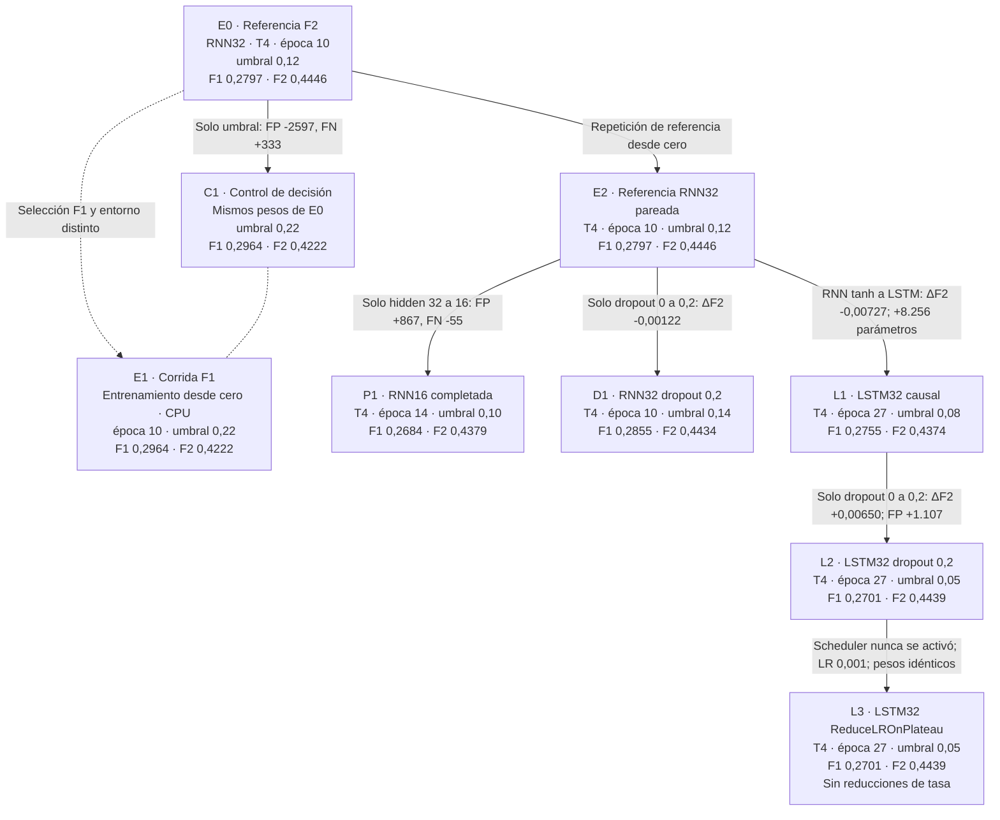

# Árbol de experimentos y cambios controlados

**Estado:** árbol actualizado con comparaciones pareadas de capacidad, dropout, arquitectura, scheduler y dropout dentro de LSTM. El generador solo representa artefactos publicados; no entrena ni evalúa modelos.

La idea de organizar corridas mediante relaciones padre–hijo existe en herramientas de seguimiento, como [las corridas anidadas de MLflow](https://mlflow.org/docs/latest/ml/traditional-ml/tutorials/hyperparameter-tuning/part1-child-runs/). Para nuestro proyecto usamos un **grafo de linaje de experimentos con forma de árbol**, con distinción explícita entre procedencia de pesos, configuración de referencia y comparación de resultados. No requiere instalar MLflow.

- [Abrir la vista interactiva](linaje_experimentos_v1/publicacion_lstm_scheduler/arbol.html): seleccionar un nodo muestra métricas, cambios, deltas y su informe.
- [Abrir el SVG](linaje_experimentos_v1/publicacion_lstm_scheduler/arbol.svg): versión estática para visualizar o compartir.
- [Registro de nodos y relaciones](linaje_experimentos_v1/publicacion_lstm_scheduler/registry.json), con hashes de las fuentes. Se conservan las publicaciones anteriores en `publicacion/`, `publicacion_pre_rnn16/`, `publicacion_rnn16/`, `publicacion_dropout/`, `publicacion_lstm/` y `publicacion_lstm_dropout/`.
- [Manifiesto de publicación](linaje_experimentos_v1/publicacion_lstm_scheduler/manifest.json).

## Cómo leerlo

Los nodos muestran el estado, tipo de ejecución, dispositivo, tamaño de la RNN, época elegida, umbral y las mismas métricas: F1, F2, precisión, recall y cobertura por evento. Las propuestas conservan métricas ausentes; no se presentan como resultados ni mejoras esperadas.

Cada flecha declara su relación:

| Relación | Significado |
|---|---|
| Verde continua: E0 → C1 | Mismos pesos, cambio de decisión. Permite medir directamente el efecto del umbral sobre esas probabilidades. |
| Naranja discontinua: E0 → E1 | Nueva corrida desde cero, basada en la configuración de referencia. Cambió selección y entorno efectivo. No representa continuación del entrenamiento ni herencia de pesos. |
| Gris: E0 → E2 | Repetición de la referencia RNN32 desde cero. Verifica reproducibilidad; no representa pesos heredados. |
| Morado: E2 → P1 | Comparación de capacidad completada en la misma T4. P1 es RNN16. |
| Rosa: E2 → D1 | Comparación controlada de dropout 0,0 → 0,2 en la misma T4. AP y BCE mejoran, pero F2 y cobertura por evento bajan ligeramente en esta semilla. |
| Azul: E2 → L1 | RNN32 tanh frente a LSTM32 causal. Aumentan los parámetros y AP, pero F2 y la cobertura por evento bajan en esta semilla. |
| Rosa: L1 → L2 | Comparación controlada de dropout 0,0 → 0,2 dentro de LSTM32. F2 y cobertura por evento suben, con más falsas alertas y AP menor; el umbral elegido cae en el límite inferior de la cuadrícula. |
| Verde azulado: L2 → L3 | Comparación controlada de tasa fija frente a `ReduceLROnPlateau`. El scheduler no redujo la tasa; los pesos y resultados quedaron idénticos. |
| Azul sin dirección: C1 — E1 | Comparación de resultados: mismos conteos a umbral 0,22. No significa pesos idénticos ni relación evolutiva. |

El color señala el tipo y las limitaciones de la comparación. No asigna automáticamente la categoría de ganador. En L2 → L3, el scheduler nunca actuó, así que el resultado no mide el efecto de una reducción efectiva de la tasa.

## Resumen en Mermaid



Contexto compartido: train 2022–2023, validación 2024, 25.635 muestras elegibles, W=8, preprocesador congelado, semilla 42 y pérdida BCE sin ponderación. Prueba final 2025 reservada.

La flecha E0 → C1 tiene ΔF1=+0,0167, ΔF2=−0,0224, 2.597 FP menos y 333 FN más. El recall por muestra baja 14,38 puntos porcentuales y la cobertura por evento baja 12,14 puntos. La comparación E0 → E1 reproduce esos conteos, pero incluye cambios de dispositivo y Python; no permite atribuir diferencias entre los entrenamientos exclusivamente al criterio F1.

## Mantener el árbol útil

Para cada comparación futura registraremos:

1. Referencia o padre, pregunta e hipótesis.
2. Factor que cambia y controles que deben permanecer fijos.
3. Diferencias efectivas encontradas en datos, población, código o entorno.
4. Estado: propuesta, en ejecución, completada o fallida.
5. Las mismas métricas, sus deltas, incertidumbre disponible y conclusión.
6. Configuración, hashes, semilla, pesos y enlaces a las evidencias.

El árbol ayuda a ordenar el diseño, pero dibujar una sola flecha no garantiza ortogonalización. Deben comprobarse los controles en los artefactos. Las ramas no necesitan mejorar y se conservan resultados negativos. Si combinamos dos cambios, se registra la interacción; si repetimos semillas, se agrupan las corridas y se muestra su variabilidad.

La vista actual tiene nueve nodos registrados explícitamente en el generador. E2 y P1 representan la pareja de capacidad; E2 y D1, dropout en RNN; E2 y L1, arquitectura recurrente; L1 y L2, dropout dentro de LSTM; L2 y L3, scheduler en la LSTM con dropout. En L1, F2 baja de 0,44463 a 0,43737, AP sube de 0,20158 a 0,20889, BCE empeora de 0,33111 a 0,40214 y la cobertura por evento baja de 652/824 a 642/824. La LSTM usa 12.377 parámetros frente a 4.121 de la RNN. En L2, dropout 0,2 eleva F2 de 0,43737 a 0,44387 y cubre 40 eventos más, con 1.107 falsas alertas adicionales; AP baja y el umbral 0,05 toca el límite inferior de la cuadrícula. En L3, `ReduceLROnPlateau` monitorizó BCE de train pero no redujo la tasa en 30 épocas; ambos hijos comparten pesos y predicciones, por lo que ΔF2=0. El resultado caracteriza esta configuración y no demuestra equivalencia general entre schedulers y tasa fija.

## Reproducción

Se requiere Python y Graphviz (`dot`). Desde esta carpeta, usar una salida nueva:

```bash
python3 -B linaje_experimentos_v1/generar_linaje.py \
  --output linaje_experimentos_v1/publicacion_siguiente
```

El generador consume JSON de métricas y manifiestos de ambas corridas y del control. No carga datos de prueba, no ajusta preprocesadores, no modifica pesos ni selecciona umbrales nuevos. La vista HTML funciona sin dependencias externas; abrirla en un navegador permite usar los nodos y sus enlaces. Los hashes registran las entradas utilizadas y las salidas de esta publicación.

La comparación E2 → P1 da ΔF2=−0,00675, FP +867 y FN −55. La cobertura por evento aumenta de 652 a 666 sobre 824; ver [el informe de capacidad](12_resultados_rnn16_pareada.md). Para E2 → D1, ver [el informe de dropout RNN](14_resultados_dropout_rnn32.md); para E2 → L1, ver [el informe de LSTM](16_resultados_lstm_rnn32.md); para L1 → L2, ver [el informe de dropout LSTM](18_resultados_lstm_dropout.md); para L2 → L3, ver [el informe del scheduler](20_resultados_lstm_scheduler.md).

Referencias del proyecto: [diseño ortogonal](../specs/05_diseno_ortogonal_experimentos.md), [referencia F2](06_resultados_rnn_v1_validacion_2024.md), [control F1](07_control_f1_sobre_pesos_f2.md) y [comparación de corridas](08_resultados_rnn_f1_y_comparacion.md).
