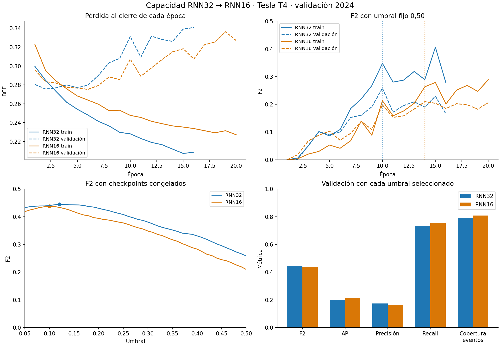

# Comparación de capacidad RNN32–RNN16 sobre validación 2024

**Estado:** pareja recibida, integridad y controles comprobados, y evaluación local de ambos modelos completada. Ambos entrenaron en GPU Tesla T4. 2025 permanece reservada.

## Procedencia y controles

- ZIP: `runs/rnn16_vs_rnn32_f2_v1_seed42.zip`.
- SHA-256: `934e084b8dc8cd671b61ec59931a6bb3d7f8f06cda58ca4a11af766c87af7b67`.
- El archivo contiene exactamente los 40 archivos declarados y `pair_manifest.json`, sin duplicados ni ZIP anidados. Se comprobaron los hashes del padre, ambos hijos y las configuraciones fuente.
- El manifiesto y el estado del padre registran `comparison_authorized=true`.
- Único cambio material configurado: `model.hidden_size`, de 32 a 16. Se conservaron embeddings de dimensión 4, rama estática de 16, capa oculta de fusión de 16, W=8, máscaras, datos y preprocesador.
- Ambos entrenaron con BCE sin ponderación, Adam, learning rate 0,001, batch 256, semilla 42, máximo de 30 épocas y paciencia de seis.
- Selección común: checkpoint por F2 a umbral fijo 0,5; después umbral en la cuadrícula 0,05–0,95 con los pesos congelados. Las épocas ejecutadas y los umbrales elegidos son resultados del protocolo, no cambios adicionales de configuración.
- Población común: 46.162 muestras elegibles de train 2022–2023 y 25.635 de validación 2024. Las claves, etiquetas, hashes de entradas, preprocesador y código coinciden entre los hijos.

El entorno fue el mismo antes, entre y después de entrenar: Tesla T4, CUDA 13.0, PyTorch 2.14.1+cu130, Python 3.13.16, NumPy 2.4.6 y pandas 2.2.3. Ambos hijos registran determinismo activado y semilla 42. El cambio inicial de flags del proceso al protocolo de entrenamiento no implica un entorno diferente entre los modelos.

## Reproducción local y referencia histórica

La evaluación local en CPU reutilizó los pesos y umbrales exportados. La máxima diferencia frente a Colab fue **5,36 × 10⁻⁷ para RNN32** y **9,54 × 10⁻⁷ para RNN16**. Ambas cumplen las tolerancias declaradas y tienen **cero cambios de decisión**.

La referencia RNN32 pareada reprodujo exactamente los bytes de los pesos y las probabilidades exportadas de la RNN32 histórica. Esto acredita reproducibilidad para esta semilla y entorno; no constituye una segunda semilla ni una estimación de estabilidad estadística.

## Resultados principales

| Métrica | RNN32 pareada | RNN16 candidata |
|---|---:|---:|
| Parámetros | 4.121 | 2.233 |
| Época elegida / ejecutadas | 10 / 16 | 14 / 20 |
| Umbral seleccionado | 0,12 | 0,10 |
| **F2** | **0,44463** | 0,43788 |
| F1 | 0,27971 | 0,26837 |
| Precisión | 17,28 % | 16,31 % |
| Recall por muestra | 73,26 % | 75,64 % |
| Average Precision | 0,20158 | 0,21246 |
| TP / FP | 1.696 / 8.116 | 1.751 / 8.983 |
| FN / TN | 619 / 15.204 | 564 / 14.337 |
| Falsos positivos por 100 decisiones | 31,66 | 35,04 |
| Entradas cubiertas | 652/824 (79,13 %) | 666/824 (80,83 %) |

RNN16 usa **45,8 % menos parámetros**. Recupera 55 muestras positivas netas y cubre 14 entradas adicionales, pero añade **867 falsos positivos**. F2 baja 0,00675 y F1 baja 0,01133. Las muestras y las entradas a boxes tienen denominadores distintos: los eventos sin cobertura pasan de 172 a 158.

El resultado no es uniforme: RNN16 recupera 226 positivos antes omitidos y pierde 171 antes detectados; ambos modelos omiten 393. Entre las muestras negativas, evita 1.629 falsas alertas anteriores y crea 2.496 nuevas. Por ello, el neto no describe todos los cambios de comportamiento.

Las mismas 969 muestras publicadas de validación quedan excluidas conforme al contrato, sin transformar desconocidos en negativos. Las alertas consecutivas por piloto-vuelta no se interpretan como incidentes independientes.

## Qué ocurrió con la generalización

| Checkpoint elegido | RNN32 | RNN16 |
|---|---:|---:|
| BCE train | 0,22816 | 0,23654 |
| BCE validación | 0,33111 | 0,31501 |
| F2 train con su umbral seleccionado | 0,61683 | 0,59771 |
| F2 validación con su umbral seleccionado | 0,44463 | 0,43788 |
| AP train | 0,52184 | 0,47957 |
| AP validación | 0,20158 | 0,21246 |

RNN16 muestra una brecha menor en BCE y AP y mejora AP de validación. Son indicios compatibles con menor sobreajuste, pero **no mejoran el objetivo principal F2 en esta corrida** y no prueban una mejora estable entre semillas o temporadas. Ambas curvas todavía muestran deterioro de BCE de validación mientras mejora entrenamiento.

Con umbral fijo 0,5, F2 también es menor para RNN16: 0,20952 frente a 0,25835. Los resultados corresponden al protocolo vigente, no a una búsqueda global de todas las combinaciones de época y umbral.



Los tiempos registrados fueron 93,4 s para RNN32 y 110,0 s para RNN16. La candidata ejecutó 20 épocas frente a 16; estos tiempos secuenciales no son un benchmark aislado de velocidad ni demuestran que reducir parámetros acelere este entrenamiento completo.

## Interpretación y siguiente decisión

La hipótesis recibió apoyo parcial: menor capacidad reduce parámetros y algunas brechas, con una mejora modesta de AP. La candidata no supera a la referencia en F2 y genera más falsas alertas con su regla seleccionada. **Se conserva RNN32 como referencia del objetivo F2 para esta validación.**

La diferencia de F2 es pequeña y se obtuvo con una sola semilla. Antes de concluir que 32 unidades son superiores de forma general, conviene repetir la comparación con otras semillas manteniendo GPU, versiones y protocolo. Una variación de regularización, pérdida o entradas sería un experimento separado.

Los cortes descriptivos orientan la revisión de errores: ronda 12 mejora F2 de 0,36310 a 0,61224; rondas 2 y 9 caen de 0,31175 a 0,18258 y de 0,50442 a 0,40615. En rondas 15 y 21 aumentan FP sin recuperar TP adicionales. Estos cortes no demuestran una causa ni sustituyen la evaluación agregada.

Validación fue reutilizada para seleccionar checkpoint y umbral, por lo que las métricas son resultados de desarrollo. El replay conserva latencia cero supuesta y no valida uso en vivo. No se entrenó localmente ni se transformó o evaluó 2025.

## Artefactos y reproducción

- Pareja extraída: `runs/rnn16_vs_rnn32_f2_v1_seed42/`.
- Evaluaciones: `eval/rnn16_vs_rnn32_f2_v1_seed42/rnn32_reference/` y `rnn16_candidate/`.
- Diagnósticos individuales: subcarpeta `analysis/` de cada evaluación.
- Comparación conjunta: `eval/rnn16_vs_rnn32_f2_v1_seed42/comparison_final/`, con CSV, JSON, figura, generador y manifiesto.
- [Árbol actualizado](linaje_experimentos_v1/publicacion_rnn16/arbol.html): E2 es la referencia pareada y P1 la RNN16 completada, comparada contra E2. Los resultados históricos permanecen visibles.

Para repetir cada evaluación, usar directorios de salida nuevos:

```bash
OMP_NUM_THREADS=2 MKL_NUM_THREADS=2 python3.13 -B scripts/evaluar_rnn.py \
  --bundle runs/rnn16_vs_rnn32_f2_v1_seed42/rnn32_reference \
  --output eval/rnn16_replay_2/rnn32_reference --device cpu

OMP_NUM_THREADS=2 MKL_NUM_THREADS=2 python3.13 -B scripts/evaluar_rnn.py \
  --bundle runs/rnn16_vs_rnn32_f2_v1_seed42/rnn16_candidate \
  --output eval/rnn16_replay_2/rnn16_candidate --device cpu
```

Para regenerar la comparación descriptiva, con matplotlib instalado:

```bash
python3.13 -B scripts/generar_comparacion_capacidad_rnn.py \
  --pair runs/rnn16_vs_rnn32_f2_v1_seed42 \
  --evaluation eval/rnn16_vs_rnn32_f2_v1_seed42 \
  --historical-reference runs/rnn_v1_seed42 \
  --output eval/rnn16_comparison_replay_2
```

El ZIP original, los pesos, umbrales y paquetes previos se conservaron. Los datos y modelos permanecen locales y fuera de Git. No se hizo commit ni push en esta evaluación.
